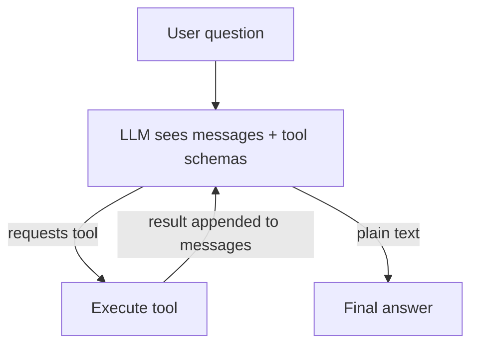
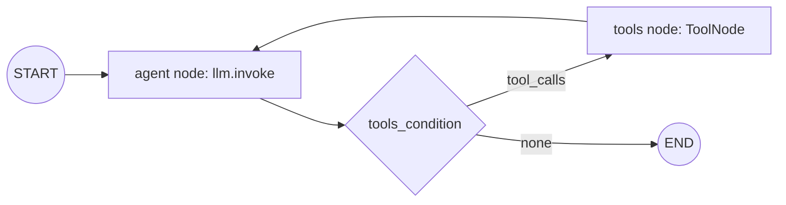
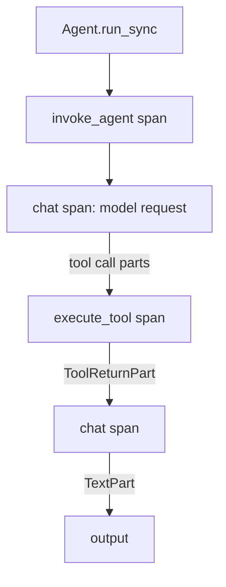
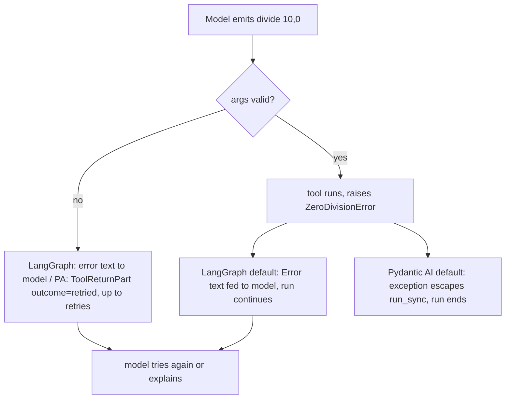
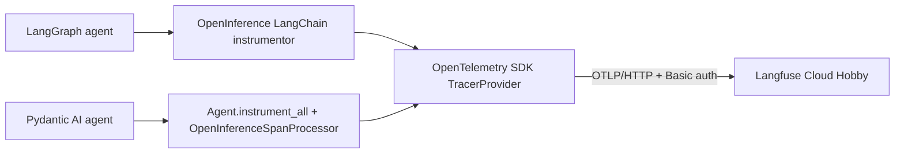

# Phase 1 Architecture

## Diagram 1 — basic agent loop

## Diagram 2 — LangGraph (observed span tree)

State: `MessagesState` (list of messages, append reducer). Loop = graph cycle. Cap = `recursion_limit` (2*MAX_STEPS+1).

## Diagram 3 — Pydantic AI (observed span tree)

Loop is internal to `Agent.run` (a pydantic-graph). State = message history + run context. Cap = `UsageLimits(request_limit)`.

## Diagram 4 — failure path

## Diagram 5 — observability path

Agent app and observability are separate; Langfuse is hosted, nothing self-hosted.

## Shared pieces (`phase-01/common/lab_common`)
`tools.py` (4 typed functions, docstrings = descriptions), `prompts.py` (instructions, MAX_STEPS=8), `dataset.py` (6 scenarios, RunResult), `evaluate.py` (scorer), `config.py` (env provider), `tracing.py`.
